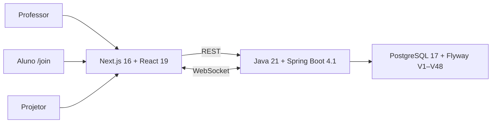

# Arena Dev

**Arena Dev** é uma plataforma proprietária e self-hosted para condução, participação e gamificação de dinâmicas de sala, com foco em baixa fricção para o professor.

> **Baseline publicada:** `v0.9.0 — Arena Learning Core`.
>
> **PR de acompanhamento:** [#35 — v0.10 (rascunho; não fazer merge)](https://github.com/wesscosta/arena-dev/pull/35).
>
> **P1-A/B em homologação:** Peer Instruction (V51) e Clínica do Erro com interpretação docente (V52). Consulta [ADR-0054](docs/adr/ADR-0054-peer-instruction-through-learning-cycle.md) e [ADR-0055](docs/adr/ADR-0055-error-clinic-teacher-annotations.md). **O bloqueio P0 de escala sob 350+ turmas foi corrigido na branch e validado em Chromium; ainda existem gates independentes de release.** Ver [ADR-0056](docs/adr/ADR-0056-dashboard-batch-bootstrap-and-lazy-mechanics.md).
>
> **Linha v0.10 em desenvolvimento:** `feat/v0.10-learning-loop` — [roadmap revisado](docs/ROADMAP_V0_10.md) e [plano técnico detalhado](docs/v0.10/IMPLEMENTATION_PLAN.md) e [registro verificável dos incrementos e gates pendentes](docs/v0.10/EXECUTION_STATUS.md) e [auditoria crítica da Arena, sorteio e materiais externos](docs/AVALIACAO_V0_10_ARENA_MATERIAIS.md).
>
> **Execução atual:** a v0.9.0 está publicada e congelada. Learning Domain, Interaction Core, LearningEvidence, AI-ready trace e shadow/cutover gate fazem parte da baseline. O legado permanece autoritativo até que a amostra operacional de shadows aprove o cutover lógico; remoção física fica para release posterior à janela de rollback.

## Modelo do produto

```text
Turmas = nível do sistema e descoberta de turmas
Turma       = contexto pedagógico
Biblioteca  = acervo global reutilizável do professor
Arena       = operação da aula ao vivo
Entregas    = fluxo assíncrono de submissão, correção e feedback
Integrações = ponte provider-independent com plataformas educacionais
```

Arena Dev não pretende ser um LMS completo. O produto concentra a condução da aula, participação dos estudantes, atividades, entregas, avaliação supervisionada e gamificação.

## Capacidades principais

### Turma e Arena
- turmas, estudantes, matrículas e presença;
- sessão de aula com estado autoritativo no backend;
- Sorteio, Nuvem de Palavras, Votação, Quiz, Buzzer e Boss Battle;
- Timer sincronizado em drawer contextual compacto e responsivo;
- grupos, duplas e trios;
- Projetor público;
- entrada do aluno por `/join`;
- ranking e histórico;
- XP auditável por `ScoreEvent`;
- timeline operacional por `SessionEvent`.

### Atividades e entregas — baseline v0.6
- `ActivitySubmission` como fonte de verdade interna da entrega;
- `SubmissionItem` polimórfico para `QUESTION_RESPONSE`, `TEXT`, `LINK`, `CODE` e referências de artefatos;
- autosave, restauração e envio;
- dashboard de entregas por atividade;
- correção individual com navegação entre estudantes;
- rubricas e critérios estruturados;
- avaliação manual separada de XP;
- correção assistida por IA sob supervisão;
- feedback individual com publicação explícita;
- preparação/triagem em lote sem autopublicação;
- evidências de processo e recomendação de revisão humana;
- fundação provider-independent para Microsoft Teams e Google Classroom.

## Invariantes de domínio

```text
ActivityQuestion     = autoria da pergunta
QuizRound            = runtime do Quiz ao vivo
ParticipantAnswer    = verdade da resposta do Quiz
ActivitySubmission   = entrega interna da atividade
SubmissionItem       = conteúdo persistido da entrega
SubmissionAssessment = avaliação da entrega
ScoreEvent           = verdade do XP
LiveStage            = estado público/apresentado
SessionEvent         = timeline operacional
```

A nota da avaliação não substitui `ScoreEvent`. XP continua sendo derivado exclusivamente de eventos de pontuação.

## IA supervisionada

A IA pode sugerir análise, pontuação por critério e feedback, mas não é autoridade da avaliação.

```text
entrega
  ↓
sugestão da IA
  ↓
professor revisa/edita/descarta
  ↓
avaliação docente
  ↓
publicação explícita
  ↓
aluno recebe publishedFeedback
```

Rascunhos, notas privadas e sugestões da IA não são publicados automaticamente nem sincronizados externamente.

## Evidências de processo

A v0.6 registra sinais operacionais para apoiar revisão humana, como eventos de salvamento, colagem, envio, tempo e similaridade textual.

Esses sinais **não** constituem detector de IA, plágio ou fraude. O sistema produz apenas recomendação de revisão (`LOW`, `MEDIUM`, `HIGH`).

## Integrações externas — v0.7

A v0.7 transforma a fundação provider-independent da v0.6 em uma camada operacional de integrações:

```text
Teams / Classroom
        ↓
Provider Adapter
        ↓
Integration Core
        ↓
Arena Dev Domain
```

Regra arquitetural: IDs, tokens e detalhes específicos de Microsoft/Google não devem contaminar `ActivitySubmission`, `Assessment`, `ScoreEvent` ou os demais agregados centrais.

A v0.7 foi encerrada com Microsoft Teams operacional sobre o Integration Core provider-independent. Google Classroom permanece em standby e não bloqueou a publicação da v0.7.0.

## Arquitetura



Princípios:

- monólito modular;
- REST para estado durável e comandos;
- WebSocket para sincronização imediata;
- backend autoritativo para sessão, XP e runtimes;
- PostgreSQL/Flyway como fonte de verdade persistente;
- integrações externas por contratos/adapters;
- evitar Redis, Kafka, Kubernetes e microserviços sem necessidade demonstrada.

## v0.6.0 — linha encerrada

```text
14.0  Bootstrap e arquitetura                         concluído
14.1  ActivitySubmission                              concluído
14.2  SubmissionItem + autosave + envio              concluído
14.3  Dashboard de entregas                           concluído
14.4  Correção individual                             concluído
14.4A Visibilidade/navegação de entregas              concluído
14.4B Fluxo visual do aluno                           concluído
14.5  Rubricas e avaliação estruturada                concluído
14.6  AI-assisted grading                             concluído
14.7  Feedback individual                             concluído
14.8  Correção em lote / triagem                      concluído
14.9  Evidências de processo e integridade            concluído
14.10 Preparação Teams/Classroom                      concluído
14.11 Hardening, E2E e release gate                   concluído
14.11A–C Polish final de UI                           concluído
```

Schema consolidado da linha: **Flyway V1–V25**.

## v0.7.0 — linha tecnicamente concluída

```text
15.0  Integration Core Consolidation                  concluído
15.1  Microsoft Identity + Graph Connection           concluído
15.2  Teams Classrooms & Students                     concluído
15.3  Activity Mapping                                concluído
15.4  Submission Import                               concluído
15.5  Grade & Feedback Sync                           concluído
15.6  Google Classroom Adapter                        standby
15.7  Integration Operations UI                       concluído
15.8  Conflict Resolution & Observability             concluído
15.9  Hardening, E2E & Release Gate                   concluído
```

Detalhes de fechamento em `docs/RELEASE_0_7.md`.

## v0.8 — linha encerrada

O `16.1 — Journey Core` introduziu a base persistente de progressão: jornadas por turma, etapas ordenadas, regras de desbloqueio, critérios de conclusão e progresso por matrícula.

O `16.2 — Learning Resources & Content Ingestion` consolidou `LearningResource`, ingestão e preview revisável. O `16.3` já entrega `/learn`, Study API independente de `/join`, Reader, progresso/retomada, prévia do professor, Builder simplificado e Journey Progression UX.

O `16.3.8 — Content Ingestion & Structured Import` evoluiu para um pipeline comum de documentos normalizados: Markdown estruturado mantém mapeamento determinístico (`H1 → título`, `H2 → módulo`, `H3 → conteúdo`), enquanto Text/File e Notion usam adapters da mesma fronteira. Notion já possui OAuth, API oficial e seleção de páginas autorizadas no Journey Builder. Toda importação continua como **snapshot revisável**, sem sincronização bidirecional silenciosa.

O `16.4 — Student Experience Shell & Workspace Visibility` já introduz Início, Jornadas, Entrar ao vivo e Conquistas no mesmo shell. `/join` continua público para QR/código e compartilha o mesmo runtime de `/learn/live`. O `16.4A` separa **matrícula** de **exposição permanente de conteúdo**: o professor decide se uma turma fica disponível no espaço de estudo, sem afetar a Arena ao vivo. A autorização está centralizada na Study API e preserva o progresso ao ocultar/reativar a turma.

`16.5 — Content Library & Reuse` avançou além do `16.5B.2`: `LearningResource` continua canônico, V38 adiciona metadata semântica editorial e estrutura derivada, a ingestão global passa por `CanonicalDocument` revisável, e a Biblioteca oferece Leitura/Estrutura/Mapa, filtros e atualização explícita de snapshots. `16.5C–F` estão na linha de fechamento da v0.8. A evolução pedagógica posterior foi separada em um eixo `17.x`: taxonomia de conhecimento, roadmaps/editais, banco de questões com proveniência, validação por evidências, Mastery, revisão e progressão visual. Nesse eixo, **ler/concluir não equivale a dominar**, e questões de concurso podem validar aprendizagem somente por conjuntos com cobertura e critérios auditáveis.

Estado final do `16.0 — Professor Arena Experience`:

- Arena orientada por ações, sem as tabs antigas de Condução/Dinâmicas/Tempo/Organização;
- sidebar persistente para Dinâmicas e Ferramentas;
- workspace full-width e rail contextual de participantes/sessão;
- Timer, Organização, Presença e **Ranking da sessão** em ferramentas contextuais;
- Timer consolidado em uma única superfície de configuração, com presets em linha única sem scroll horizontal e baseline 1366×768 sem scroll vertical obrigatório;
- Pontuação Rápida transversal;
- Ranking deriva exclusivamente de `ScoreEvent` da sessão, suporta empates, Top 5/Todos, atualização realtime e projeção explícita com opção de ocultar nomes;
- a projeção do Ranking é paralela ao `LiveStage`, preservando a dinâmica em andamento quando o professor a exibe/oculta;
- Ranking da sessão não é Mastery nem leaderboard permanente: não existem ranking global, ligas, temporadas ou recompensa automática por posição;
- Sorteio Inteligente 2.0 com seleção autoritativa no backend, marcador fixo e animação com aceleração/desaceleração;
- roleta SVG circular com slots adaptativos, quantidade ímpar de casas visíveis e slot neutro para preservar percepção de justiça em turmas pares;
- rail de participantes com filtro Presentes/Todos e ferramentas contextuais estáveis para Timer, Organização, Presença e Pontuação Rápida;
- QR ampliável, indicadores de online/presença consolidados e selects com contraste consistente no tema escuro;
- Quiz, Votação, Nuvem de Palavras, Buzzer e Boss Battle ocupando a altura disponível do cockpit em desktop;
- quality gate técnico `16.0F.18` concluído: CSS legado da roleta removido, responsividade desktop validada, estados vazios explícitos e drawers com contenção/retorno de foco; os passes `16.0F.19/20` fecharam consistência visual e Projetor antes do merge no PR #21.

Roadmap e estado detalhado em `docs/ROADMAP_0_8.md`, `docs/INCREMENT_16_3.md` e `docs/INCREMENT_16_2.md`.

## v0.9.0 — linha publicada e congelada

A v0.9 consolida o **Arena Learning Core** como fundação pedagógica estruturada, sem remover prematuramente os runtimes legados:

- `LearningTarget`, `ContentRef` e `Provenance` como base semântica;
- `InteractionDefinition → InteractionRun → Response → Evaluation → Result`;
- `LearningEvidence` persistida no fluxo nativo **Verificar aprendizagem**, sem XP automático;
- Quiz, Poll e Word Cloud integrados ao novo core por adapters/shadow validation;
- trace estruturado AI-ready por `InteractionRun`, com `aiReady` e lacunas explícitas;
- observações duráveis `EQUIVALENT / MISMATCH / SYNC_ERROR`;
- cutover lógico fail-closed, condicionado à evidência operacional real;
- legado preservado como autoridade e rollback durante a primeira release;
- Flyway consolidado até **V48**.

O cutover lógico **não acontece automaticamente com a publicação da v0.9.0**. Por padrão, cada tipo precisa atingir a amostra mínima de rodadas terminais equivalentes e não pode ter divergência não resolvida. A exclusão física do legado pertence a uma release posterior à janela de rollback.

A próxima linha planejada é **v0.10 — Learning Loop**, com evolução das intervenções pedagógicas, Confidence, Before & After, Error Clinic, Recovery e Mastery v1. Essas capacidades não fazem parte da baseline v0.9.0.

## Executando localmente

```bash
git clone https://github.com/wesscosta/arena-dev.git
cd arena-dev
cp .env.example .env
docker compose up -d --build
docker compose ps
```

Frontend: `http://localhost:3000`

Backend: `http://localhost:8080`

Readiness: `http://localhost:8080/api/health/ready`

Liveness: `http://localhost:8080/api/health/live`

Em acesso pela rede local, compartilhe apenas o frontend, por exemplo `http://<IP-DA-MAQUINA>:3000`. No perfil Docker de desenvolvimento, o browser usa essa mesma origem para `/api/*` e `/ws/*`, e o Next.js encaminha as requisições para o backend pela rede interna do Compose. Assim, Join, Learn e tempo real não dependem de a porta `:8080` estar acessível no dispositivo do aluno.

## Gates de desenvolvimento

Backend:

```bash
cd backend
mvn -B -ntp verify
```

Frontend:

```bash
cd frontend
npm test
npm run typecheck
npm run build
```

Gate local:

```bash
scripts/release/release-gate.sh local
```

O histórico detalhado de release permanece em `docs/RELEASE_0_6.md`. A documentação não deve afirmar tag/GitHub Release sem evidência verificável no mesmo SHA.

## Documentação corrente

- [`docs/STATUS_ATUAL.md`](docs/STATUS_ATUAL.md)
- [`docs/ROADMAP_0_8.md`](docs/ROADMAP_0_8.md)
- [`docs/CONTENT_CANONICAL_MARKDOWN.md`](docs/CONTENT_CANONICAL_MARKDOWN.md)
- [`docs/ARCHITECTURE_STABILIZATION_GATE_V0_8.md`](docs/ARCHITECTURE_STABILIZATION_GATE_V0_8.md)
- [`docs/INCREMENT_16_3.md`](docs/INCREMENT_16_3.md)
- [`docs/INCREMENT_16_2.md`](docs/INCREMENT_16_2.md)
- [`docs/INCREMENT_16_0.md`](docs/INCREMENT_16_0.md)
- [`docs/INCREMENT_16_0R_SESSION_RANKING.md`](docs/INCREMENT_16_0R_SESSION_RANKING.md)
- [`docs/ROADMAP_0_7.md`](docs/ROADMAP_0_7.md)
- [`docs/DOCUMENTATION_INDEX.md`](docs/DOCUMENTATION_INDEX.md)
- [`docs/DESIGN_SYSTEM.md`](docs/DESIGN_SYSTEM.md)
- [`docs/ACCESSIBILITY.md`](docs/ACCESSIBILITY.md)
- [`docs/LEARNING_VALIDATION_ROADMAP.md`](docs/LEARNING_VALIDATION_ROADMAP.md)
- [`docs/CLASSROOM_OVERVIEW_MVP_CONSOLIDATION.md`](docs/CLASSROOM_OVERVIEW_MVP_CONSOLIDATION.md)
- [`docs/adr/README.md`](docs/adr/README.md)

Histórico da v0.6:

- [`docs/ROADMAP_0_6.md`](docs/ROADMAP_0_6.md)
- [`docs/RELEASE_0_6.md`](docs/RELEASE_0_6.md)
- `docs/INCREMENT_14_*`
- `docs/POLISH_14_11*`

## Estado das linhas

- `v0.3.x` — histórica;
- `v0.4.x` — histórica;
- `v0.5.0` — histórica;
- `v0.6.0` — baseline técnica encerrada e congelada;
- `v0.7.0` — Educational Integrations; publicada e encerrada;
- `v0.8.0` — Professor Experience & Journey MVP; publicada, encerrada e congelada em V38;
- `v0.9` — **Arena Learning Core em fechamento arquitetural**; schema aditivo até V48, fluxo nativo `Verificar aprendizagem` operando de LearningTarget até LearningEvidence, trace AI-ready estruturado e shadows de Quiz/Poll/Nuvem com observações duráveis e gate objetivo de cutover. A remoção física do legado permanece bloqueada até a janela segura de rollback; consulte `docs/v0.9/FINAL_ARCHITECTURE_GATE.md`.

## Licença

A baseline atual é **proprietária**. A fronteira canônica é: `v0.1.x`–`v0.4.x` como **Arena Dev Community / MIT** e o primeiro commit da linha `v0.5` em diante sob a **Arena Dev Proprietary License**; consulte [`LICENSE`](LICENSE).

O saneamento do histórico realizado antes da v0.9.0 preservou integralmente a v0.4.0 e reescreveu apenas os descendentes v0.5+ para aplicar a política de produto correta. O registro está em [`LICENSING_HISTORY.md`](LICENSING_HISTORY.md), ADR-0026 e ADR-0050.


### Student Live — 16.4B

O Student Shell descobre sessões ativas das matrículas do aluno em `/learn/live`, mantém entrada manual por código e reutiliza o mesmo runtime público de `/join`.


### Journey Redemption — 16.4C

Jornadas publicadas compatíveis podem ser distribuídas por código e vinculadas ao perfil leve do aluno sem criar matrícula artificial. O código é usado apenas no resgate; acesso e progresso persistem depois.

### Fechamento do Student Experience — 16.4

Checkpoint funcional/visual encerrado em **28/09/2026** para `16.4A–16.4C` e para o refinamento transversal do Student Shell.

- workspace persistente do aluno separado de `/join`;
- visibilidade de Journey controlada pelo professor;
- aluno pode pertencer a múltiplas turmas;
- Live discovery integrado ao Student Shell;
- Journey discovery/redemption;
- Home, Journey e Reader refinados;
- progresso sequencial, retomada e capítulos recolhíveis;
- zoom global da área de estudos (80–200%), preservando o chrome da aplicação;
- Style Guide do Student Shell com critérios de acessibilidade;
- descrições/excerpts de importação sanitizados para não expor metadados técnicos ao aluno.

Esse registro descreve o gate histórico daquele fechamento. Desde então, 16.4D — Achievements Foundation e a base de 16.5 — Content Library & Reuse até 16.5B.2 foram implementados; o estado corrente está nas seções mais recentes deste README.

Detalhes e pendências: [`docs/CLOSURE_16_4_STUDENT_EXPERIENCE.md`](docs/CLOSURE_16_4_STUDENT_EXPERIENCE.md).

### 16.4D — Achievements Foundation

Implementado em 28/09/2026. Conquistas agora são marcos persistentes derivados do progresso real do Student: **Primeiro Passo**, **Primeiro Capítulo** e **Primeira Jornada**. A fundação é idempotente, global ao aluno/multi-turma, reconcilia progresso anterior e cobre tanto matrícula quanto Journey adicionada por redemption. Não concede XP, não altera progresso e não possui endpoint público de unlock.

Detalhes: docs/INCREMENT_16_4D.md. Com A–D implementados, o **16.4 está tecnicamente completo**; hardening de release permanece separado.

### 16.5.0 — Content Library Architecture Audit

Concluído em 28/09/2026. A auditoria determinou que a Biblioteca deve evoluir LearningResource, evitando um ContentLibraryItem paralelo. Antes da V37 será necessário separar o recurso editável do snapshot executável da Journey e resolver ownership sem inventar uma entidade de professor que ainda não existe no modelo persistente.

Detalhes: docs/INCREMENT_16_5_0_ARCHITECTURE_AUDIT.md.

### 16.5A — Library Core

A Content Library agora possui núcleo persistente e API administrativa. LearningResource foi evoluído sem duplicação de domínio e Journeys materializam snapshots imutáveis do recurso/revisão usada. Consulte docs/INCREMENT_16_5A.md.

### 16.5B — Library Workspace & Reuse

A Biblioteca agora possui workspace global do professor, autoria manual, busca, archive/restore e reuso bidirecional com o Journey Builder. O snapshot continua pertencendo à Journey; editar ou arquivar o material não altera Journeys existentes. Consulte docs/INCREMENT_16_5B.md.

### Sequência de fechamento da v0.8

O **Gate de Estabilização Arquitetural v0.8** foi concluído, os cortes `16.5C–F` foram fechados no escopo MVP e a v0.8.0 foi publicada/congelada. O desenvolvimento funcional corrente ocorre na **v0.9 — Arena Learning Core**; a linha `v0.8.x` fica restrita a regressão, segurança, acessibilidade crítica e documentação.

A futura `16.6 — Knowledge & Retrieval Foundation` fica fora do gate da v0.8: chunks, índices lexical/vetorial, embeddings, avaliação de retrieval e RAG/LLM só serão iniciados depois da estabilização do corpus e da Biblioteca.

O eixo pedagógico seguinte é `17.x` e também não bloqueia a v0.8. A ordem começa por auditoria do modelo de evidência, depois taxonomia e roadmaps/editais, banco de questões com proveniência, Assessment Blueprint + Mastery, revisão/retenção e somente então progressão visual/avatar. Detalhes em [`docs/LEARNING_VALIDATION_ROADMAP.md`](docs/LEARNING_VALIDATION_ROADMAP.md).

### 16.5B.2 — Journey Snapshot Integrity Hardening — implementado

A materialização Biblioteca → Journey agora é explícita: updates comuns preservam a revisão já copiada, inclusive quando a origem foi posteriormente editada ou arquivada. `JourneyStage.updateConfiguration()` não toca no snapshot; `materializeResource()` é a fronteira de escrita. O 16.5E concluiu a atualização explícita entre revisões apenas em Journey `DRAFT`.
