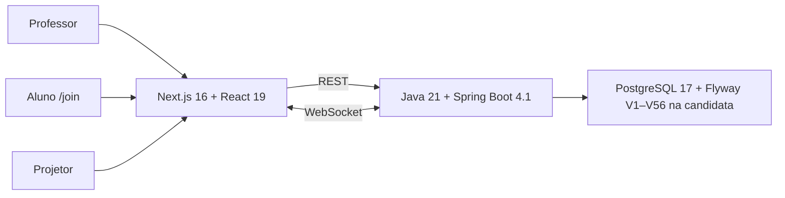

# Arena Dev

**Arena Dev** é uma plataforma proprietária e self-hosted para condução, participação e gamificação de dinâmicas de sala, com foco em baixa fricção para o professor.

**Estado do produto (10/10/2026)**

**Release v0.10.0:** publicada a partir da `main`, com contratos Flyway V56 e aceite operacional do responsável. [Aceite](docs/v0.10/OPERATOR_ACCEPTANCE_2026-10-10.md) · [Release notes](docs/RELEASE_0_10.md).

- **Publicada:** `v0.10.0 — Learning Loop` (atual). `v0.9.0` permanece congelada como baseline anterior.
- **Integração:** [PR #35](https://github.com/wesscosta/arena-dev/pull/35) incorporada na `main`, release estável `v0.10.0`.
- **v0.11 — fechamento técnico:** etapas 11.0–11.6 integradas à `main` (merge `2c1e011`), [CI aprovado](https://github.com/wesscosta/arena-dev/actions/runs/38098271861). **Homologação operacional NO-GO**: testes físicos, piloto, rollback, segurança e aceite pendentes. **Sem tag/release v0.11.0**; [registro formal](docs/v0.11/11.6_TECHNICAL_CLOSURE_NO_GO_2026-10-10.md).
- **v0.12 — planejamento reservado:** [redesign no Figma Transportta e Active Learning](docs/ROADMAP_V0_12.md), sem misturar escopo à v0.11.
- **Validação:** código da candidata consolidado até `d876325` (10/10); última bateria local informada: frontend 319/319 testes unitários, TypeScript, build, testes Playwright direcionados do Timer (2/2) e lint sem erros. **O CI remoto precisa aprovar o SHA final**, inclusive commits de documentação. A aprovação de UX em Safari/iOS foi **declarada pelo operador em 10/10**, sem relatório formal de dispositivos/roteiro, e não certifica atualização de PWA previamente instalada.
- **Evidência adicional:** ensaio isolado de rollback [V48→V56→V48 aprovado em 10/10](docs/v0.10/ROLLBACK_V56_SYNTHETIC_2026-10-10.md); **não** equivale a restauração operacional com RTO/RPO.
- **Aceite operacional:** os testes manuais foram declarados aprovados pelo operador em 10/10; os artefatos individuais e métricas RTO/RPO não foram anexados. A release foi concluída somente após a verificação técnica (CI, backup/restauração V56 e gate final). Manter as limitações e riscos residuais documentados.

Comece por [estado corrente](docs/STATUS_ATUAL.md), [checklist de release](docs/v0.10/RELEASE_CANDIDATE_CHECKLIST.md), [aceite operacional](docs/v0.10/OPERATIONAL_ACCEPTANCE.md) e [auditoria de consolidação](docs/v0.10/AUDITORIA_CONSOLIDACAO_2026-10-09.md). A trilha histórica e os ADRs ficam no [índice documental](docs/DOCUMENTATION_INDEX.md).

## Modelo do produto

```text
Turmas = nível do sistema e descoberta de turmas
Turma       = contexto pedagógico
Biblioteca  = acervo global reutilizável do professor
Arena       = operação da aula ao vivo
Entregas    = fluxo assíncrono de submissão, correção e feedback
Integrações = ponte provider-independent com plataformas educacionais
```

Arena Dev não pretende ser um LMS completo. O produto concentra a condução da aula, participação dos estudantes, atividades, entregas, avaliação supervisionada e gamificação.

## Capacidades principais

### Turma e Arena

**Navegação da Arena (v0.10, candidata):** no desktop, menu lateral persistente; no mobile, menu único com Aula, Dinâmicas, Ferramentas e Evidências da aprendizagem. Material e Evidências deixam o cabeçalho e permanecem disponíveis durante toda a sessão; o projetor conserva seu controle global. Orientações pedagógicas permanecem fundamentadas em evidências, sem o antigo atalho genérico “Próximas ações”. Consulte [`docs/ux/arena-mobile-navigation.md`](docs/ux/arena-mobile-navigation.md). O operador declarou aprovado o conjunto de testes manuais (Safari/iOS/DevTools e demais gates) em 10/10; os relatórios individuais permanecem não anexados ao repositório. O Timer permite rolagem integral no drawer com scrollbar oculta. Destaques `<aside>` do Notion são renderizados como blocos Markdown seguros. A projeção sincronizada de materiais foi incluída no [backlog v0.11](docs/ROADMAP_V0_11.md), sem implementação na v0.10.

- turmas, estudantes, matrículas e presença;
- sessão de aula com estado autoritativo no backend;
- Sorteio, Nuvem de Palavras, Votação, Quiz, Buzzer e Boss Battle;
- Timer sincronizado em drawer contextual compacto e responsivo;
- grupos, duplas e trios;
- Projetor público;
- entrada do aluno por `/join`;
- ranking e histórico;
- XP auditável por `ScoreEvent`;
- timeline operacional por `SessionEvent`.

### Atividades e entregas — baseline v0.6
- `ActivitySubmission` como fonte de verdade interna da entrega;
- `SubmissionItem` polimórfico para `QUESTION_RESPONSE`, `TEXT`, `LINK`, `CODE` e referências de artefatos;
- autosave, restauração e envio;
- dashboard de entregas por atividade;
- correção individual com navegação entre estudantes;
- rubricas e critérios estruturados;
- avaliação manual separada de XP;
- correção assistida por IA sob supervisão;
- feedback individual com publicação explícita;
- preparação/triagem em lote sem autopublicação;
- evidências de processo e recomendação de revisão humana;
- fundação provider-independent para Microsoft Teams e Google Classroom.

## Invariantes de domínio

```text
ActivityQuestion     = autoria da pergunta
QuizRound            = runtime do Quiz ao vivo
ParticipantAnswer    = verdade da resposta do Quiz
ActivitySubmission   = entrega interna da atividade
SubmissionItem       = conteúdo persistido da entrega
SubmissionAssessment = avaliação da entrega
ScoreEvent           = verdade do XP
LiveStage            = estado público/apresentado
SessionEvent         = timeline operacional
```

A nota da avaliação não substitui `ScoreEvent`. XP continua sendo derivado exclusivamente de eventos de pontuação.

## IA supervisionada

A IA pode sugerir análise, pontuação por critério e feedback, mas não é autoridade da avaliação.

```text
entrega
  ↓
sugestão da IA
  ↓
professor revisa/edita/descarta
  ↓
avaliação docente
  ↓
publicação explícita
  ↓
aluno recebe publishedFeedback
```

Rascunhos, notas privadas e sugestões da IA não são publicados automaticamente nem sincronizados externamente.

## Evidências de processo

A v0.6 registra sinais operacionais para apoiar revisão humana, como eventos de salvamento, colagem, envio, tempo e similaridade textual.

Esses sinais **não** constituem detector de IA, plágio ou fraude. O sistema produz apenas recomendação de revisão (`LOW`, `MEDIUM`, `HIGH`).

## Integrações externas — v0.7

A v0.7 transforma a fundação provider-independent da v0.6 em uma camada operacional de integrações:

```text
Teams / Classroom
        ↓
Provider Adapter
        ↓
Integration Core
        ↓
Arena Dev Domain
```

Regra arquitetural: IDs, tokens e detalhes específicos de Microsoft/Google não devem contaminar `ActivitySubmission`, `Assessment`, `ScoreEvent` ou os demais agregados centrais.

A v0.7 foi encerrada com Microsoft Teams operacional sobre o Integration Core provider-independent. Google Classroom permanece em standby e não bloqueou a publicação da v0.7.0.

## Arquitetura



Princípios:

- monólito modular;
- REST para estado durável e comandos;
- WebSocket para sincronização imediata;
- backend autoritativo para sessão, XP e runtimes;
- PostgreSQL/Flyway como fonte de verdade persistente;
- integrações externas por contratos/adapters;
- evitar Redis, Kafka, Kubernetes e microserviços sem necessidade demonstrada.

## v0.6.0 — linha encerrada

```text
14.0  Bootstrap e arquitetura                         concluído
14.1  ActivitySubmission                              concluído
14.2  SubmissionItem + autosave + envio              concluído
14.3  Dashboard de entregas                           concluído
14.4  Correção individual                             concluído
14.4A Visibilidade/navegação de entregas              concluído
14.4B Fluxo visual do aluno                           concluído
14.5  Rubricas e avaliação estruturada                concluído
14.6  AI-assisted grading                             concluído
14.7  Feedback individual                             concluído
14.8  Correção em lote / triagem                      concluído
14.9  Evidências de processo e integridade            concluído
14.10 Preparação Teams/Classroom                      concluído
14.11 Hardening, E2E e release gate                   concluído
14.11A–C Polish final de UI                           concluído
```

Schema consolidado da linha: **Flyway V1–V25**.

## v0.7.0 — linha tecnicamente concluída

```text
15.0  Integration Core Consolidation                  concluído
15.1  Microsoft Identity + Graph Connection           concluído
15.2  Teams Classrooms & Students                     concluído
15.3  Activity Mapping                                concluído
15.4  Submission Import                               concluído
15.5  Grade & Feedback Sync                           concluído
15.6  Google Classroom Adapter                        standby
15.7  Integration Operations UI                       concluído
15.8  Conflict Resolution & Observability             concluído
15.9  Hardening, E2E & Release Gate                   concluído
```

Detalhes de fechamento em `docs/RELEASE_0_7.md`.

## v0.8 — linha encerrada

O `16.1 — Journey Core` introduziu a base persistente de progressão: jornadas por turma, etapas ordenadas, regras de desbloqueio, critérios de conclusão e progresso por matrícula.

O `16.2 — Learning Resources & Content Ingestion` consolidou `LearningResource`, ingestão e preview revisável. O `16.3` já entrega `/learn`, Study API independente de `/join`, Reader, progresso/retomada, prévia do professor, Builder simplificado e Journey Progression UX.

O `16.3.8 — Content Ingestion & Structured Import` evoluiu para um pipeline comum de documentos normalizados: Markdown estruturado mantém mapeamento determinístico (`H1 → título`, `H2 → módulo`, `H3 → conteúdo`), enquanto Text/File e Notion usam adapters da mesma fronteira. Notion já possui OAuth, API oficial e seleção de páginas autorizadas no Journey Builder. Toda importação continua como **snapshot revisável**, sem sincronização bidirecional silenciosa.

O `16.4 — Student Experience Shell & Workspace Visibility` já introduz Início, Jornadas, Entrar ao vivo e Conquistas no mesmo shell. `/join` continua público para QR/código e compartilha o mesmo runtime de `/learn/live`. O `16.4A` separa **matrícula** de **exposição permanente de conteúdo**: o professor decide se uma turma fica disponível no espaço de estudo, sem afetar a Arena ao vivo. A autorização está centralizada na Study API e preserva o progresso ao ocultar/reativar a turma.

`16.5 — Content Library & Reuse` avançou além do `16.5B.2`: `LearningResource` continua canônico, V38 adiciona metadata semântica editorial e estrutura derivada, a ingestão global passa por `CanonicalDocument` revisável, e a Biblioteca oferece Leitura/Estrutura/Mapa, filtros e atualização explícita de snapshots. `16.5C–F` estão na linha de fechamento da v0.8. A evolução pedagógica posterior foi separada em um eixo `17.x`: taxonomia de conhecimento, roadmaps/editais, banco de questões com proveniência, validação por evidências, Mastery, revisão e progressão visual. Nesse eixo, **ler/concluir não equivale a dominar**, e questões de concurso podem validar aprendizagem somente por conjuntos com cobertura e critérios auditáveis.

Estado final do `16.0 — Professor Arena Experience`:

- Arena orientada por ações, sem as tabs antigas de Condução/Dinâmicas/Tempo/Organização;
- sidebar persistente para Dinâmicas e Ferramentas;
- workspace full-width e rail contextual de participantes/sessão;
- Timer, Organização, Presença e **Ranking da sessão** em ferramentas contextuais;
- Timer consolidado em uma única superfície de configuração, com presets em linha única sem scroll horizontal e baseline 1366×768 sem scroll vertical obrigatório;
- Pontuação Rápida transversal;
- Ranking deriva exclusivamente de `ScoreEvent` da sessão, suporta empates, Top 5/Todos, atualização realtime e projeção explícita com opção de ocultar nomes;
- a projeção do Ranking é paralela ao `LiveStage`, preservando a dinâmica em andamento quando o professor a exibe/oculta;
- Ranking da sessão não é Mastery nem leaderboard permanente: não existem ranking global, ligas, temporadas ou recompensa automática por posição;
- Sorteio Inteligente 2.0 com seleção autoritativa no backend, marcador fixo e animação com aceleração/desaceleração;
- roleta SVG circular com slots adaptativos, quantidade ímpar de casas visíveis e slot neutro para preservar percepção de justiça em turmas pares;
- rail de participantes com filtro Presentes/Todos e ferramentas contextuais estáveis para Timer, Organização, Presença e Pontuação Rápida;
- QR ampliável, indicadores de online/presença consolidados e selects com contraste consistente no tema escuro;
- Quiz, Votação, Nuvem de Palavras, Buzzer e Boss Battle ocupando a altura disponível do cockpit em desktop;
- quality gate técnico `16.0F.18` concluído: CSS legado da roleta removido, responsividade desktop validada, estados vazios explícitos e drawers com contenção/retorno de foco; os passes `16.0F.19/20` fecharam consistência visual e Projetor antes do merge no PR #21.

Roadmap e estado detalhado em `docs/ROADMAP_0_8.md`, `docs/INCREMENT_16_3.md` e `docs/INCREMENT_16_2.md`.

## v0.9.0 — linha publicada e congelada

A v0.9 consolida o **Arena Learning Core** como fundação pedagógica estruturada, sem remover prematuramente os runtimes legados:

- `LearningTarget`, `ContentRef` e `Provenance` como base semântica;
- `InteractionDefinition → InteractionRun → Response → Evaluation → Result`;
- `LearningEvidence` persistida no fluxo nativo **Verificar aprendizagem**, sem XP automático;
- Quiz, Poll e Word Cloud integrados ao novo core por adapters/shadow validation;
- trace estruturado AI-ready por `InteractionRun`, com `aiReady` e lacunas explícitas;
- observações duráveis `EQUIVALENT / MISMATCH / SYNC_ERROR`;
- cutover lógico fail-closed, condicionado à evidência operacional real;
- legado preservado como autoridade e rollback durante a primeira release;
- Flyway consolidado até **V48**.

O cutover lógico **não acontece automaticamente com a publicação da v0.9.0**. Por padrão, cada tipo precisa atingir a amostra mínima de rodadas terminais equivalentes e não pode ter divergência não resolvida. A exclusão física do legado pertence a uma release posterior à janela de rollback.

A próxima linha candidata é **v0.10 — Learning Loop**, com intervenções pedagógicas, autoconfiança opcional, Before & After, Clínica do Erro e recuperação assistida por evidências. **Mastery longitudinal não integra a v0.10** e permanece dependente de identidade, retenção e instrumentos adequados. Essas capacidades não fazem parte da baseline publicada v0.9.0.

## Executando localmente

```bash
git clone https://github.com/wesscosta/arena-dev.git
cd arena-dev
cp .env.example .env
docker compose up -d --build
docker compose ps
```

Frontend: `http://localhost:3000`

Backend: `http://localhost:8080`

Readiness: `http://localhost:8080/api/health/ready`

Liveness: `http://localhost:8080/api/health/live`

Em acesso pela rede local, compartilhe apenas o frontend, por exemplo `http://<IP-DA-MAQUINA>:3000`. No perfil Docker de desenvolvimento, o browser usa essa mesma origem para `/api/*` e `/ws/*`, e o Next.js encaminha as requisições para o backend pela rede interna do Compose. Assim, Join, Learn e tempo real não dependem de a porta `:8080` estar acessível no dispositivo do aluno. O banco e o backend de desenvolvimento escutam só em `127.0.0.1` (`POSTGRES_BIND`, `BACKEND_BIND`); os aparelhos da sala usam apenas o frontend. Não exponha o banco na rede da sala, porque a senha padrão de `.env.example` é pública.

## Operação em sala

Para usar com uma turma, prefira `scripts/arena.sh` ao `docker compose` direto. Ele usa o perfil de sala (`compose.yaml` + `compose.classroom.yaml`): só o frontend fica acessível na rede, Postgres e backend ficam sem porta publicada, e os serviços reiniciam sozinhos.

```bash
scripts/arena.sh install     # cria o .env com senhas aleatórias e sobe tudo
scripts/arena.sh status      # serviços, saúde e endereço para os alunos
scripts/arena.sh backup      # aceita --keep N e --encrypt-to <chave-age>
scripts/arena.sh upgrade     # backup, git pull, rebuild e conferência de saúde
scripts/arena.sh restore ARQUIVO
```

O `install` mostra a senha do professor uma única vez; depois ela fica só no `.env` (permissão 600). O script recusa subir com as senhas de exemplo do `.env.example`. Se o banco já foi criado com a senha antiga, trocar `POSTGRES_PASSWORD` no `.env` não muda a senha dentro do volume: faça backup, recrie o volume e restaure.

HTTPS é opcional (`ARENA_HTTPS=1` e `ARENA_HOSTNAME` no `.env`). Ele acrescenta `compose.https.yaml`, um Caddy com certificado próprio na porta 443. Serve para a PWA instalar o service worker nos celulares. O custo é que cada aparelho precisa confiar no certificado raiz, exportado com `scripts/arena.sh https-ca arena-ca.crt`. Sem isso, o navegador mostra alerta de segurança. Em HTTP o Arena funciona normalmente, só sem instalação como app.

Roteiro:

- **Antes da aula:** `scripts/arena.sh status`, confira "Saúde: OK", projete o endereço `/join` e teste a entrada com um celular.
- **Durante a aula:** se um aluno perder a conexão, a página reconecta sozinha. Se a máquina reiniciar, os serviços voltam sozinhos; confira com `status`.
- **Depois da aula:** `scripts/arena.sh backup` (com `BACKUP_KEEP`, os backups antigos são apagados).
- **Atualização:** fora do horário de aula, `scripts/arena.sh upgrade`. Se a nova versão não ficar saudável, o script mostra o commit anterior e o backup para voltar.
- **Restauração:** `scripts/arena.sh restore ARQUIVO` valida o dump num Postgres temporário, faz um backup de segurança e só então substitui o banco.

## Gates de desenvolvimento

Backend:

```bash
cd backend
mvn -B -ntp verify
```

Frontend:

```bash
cd frontend
npm test
npm run typecheck
npm run build
```

Gate local:

```bash
scripts/release/release-gate.sh local
```

O histórico detalhado de release permanece em `docs/RELEASE_0_6.md`. A documentação não deve afirmar tag/GitHub Release sem evidência verificável no mesmo SHA.

## Documentação corrente

- [Estado do projeto](docs/STATUS_ATUAL.md) · [Índice e histórico](docs/DOCUMENTATION_INDEX.md)
- [Plano da v0.10](docs/v0.10/IMPLEMENTATION_PLAN.md) · [Registro de execução](docs/v0.10/EXECUTION_STATUS.md)
- [Checklist GO/NO-GO](docs/v0.10/RELEASE_CANDIDATE_CHECKLIST.md) · [Aceite operacional](docs/v0.10/OPERATIONAL_ACCEPTANCE.md)
- [Design System](docs/DESIGN_SYSTEM.md) · [Acessibilidade](docs/ACCESSIBILITY.md)
- [Contratos da Biblioteca](docs/CONTENT_CANONICAL_MARKDOWN.md) · [ADRs](docs/adr/README.md)

As documentações de incrementos 14.x/16.x e os relatórios de releases anteriores são **históricos**, não requisitos ainda pendentes da v0.10.

## Estado das linhas

- `v0.3.x` — histórica;
- `v0.4.x` — histórica;
- `v0.5.0` — histórica;
- `v0.6.0` — baseline técnica encerrada e congelada;
- `v0.7.0` — Educational Integrations; publicada e encerrada;
- `v0.8.0` — Professor Experience & Journey MVP; publicada, encerrada e congelada em V38;
- `v0.9.0` — **Arena Learning Core publicada e congelada**; schema aditivo até V48, fluxo nativo `Verificar aprendizagem` operando de LearningTarget até LearningEvidence, trace AI-ready estruturado e shadows de Quiz/Poll/Nuvem com observações duráveis e gate objetivo de cutover. A remoção física do legado permanece bloqueada até a janela segura de rollback; consulte `docs/v0.9/FINAL_ARCHITECTURE_GATE.md`.

- `v0.10.0` — **publicada e congelada** (Flyway V56); compatibilidade, release e limites em [notas de release](docs/RELEASE_0_10.md).

## Licença

A baseline atual é **proprietária**. A fronteira canônica é: `v0.1.x`–`v0.4.x` como **Arena Dev Community / MIT** e o primeiro commit da linha `v0.5` em diante sob a **Arena Dev Proprietary License**; consulte [`LICENSE`](LICENSE).

O saneamento do histórico realizado antes da v0.9.0 preservou integralmente a v0.4.0 e reescreveu apenas os descendentes v0.5+ para aplicar a política de produto correta. O registro está em [`LICENSING_HISTORY.md`](LICENSING_HISTORY.md), ADR-0026 e ADR-0050.


Os registros históricos de Student Live, Journey Redemption, Achievements e Biblioteca 16.4–16.5 permanecem nos documentos `docs/INCREMENT_16_*`, em [`docs/CLOSURE_16_4_STUDENT_EXPERIENCE.md`](docs/CLOSURE_16_4_STUDENT_EXPERIENCE.md) e no histórico Git. Eles não são a fonte operacional da candidata v0.10.
